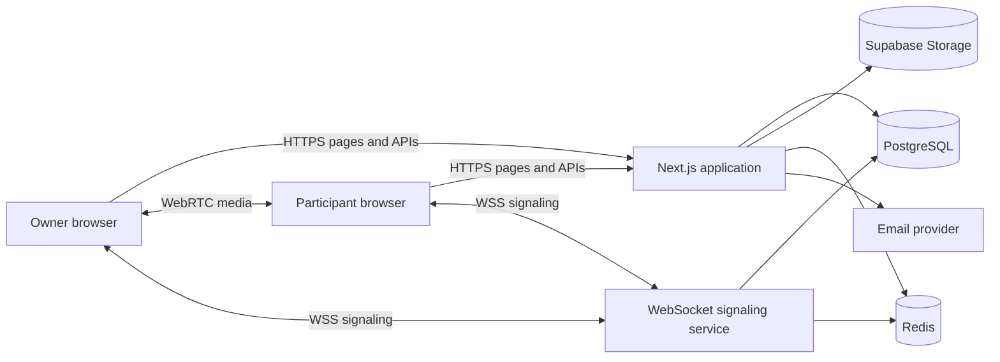
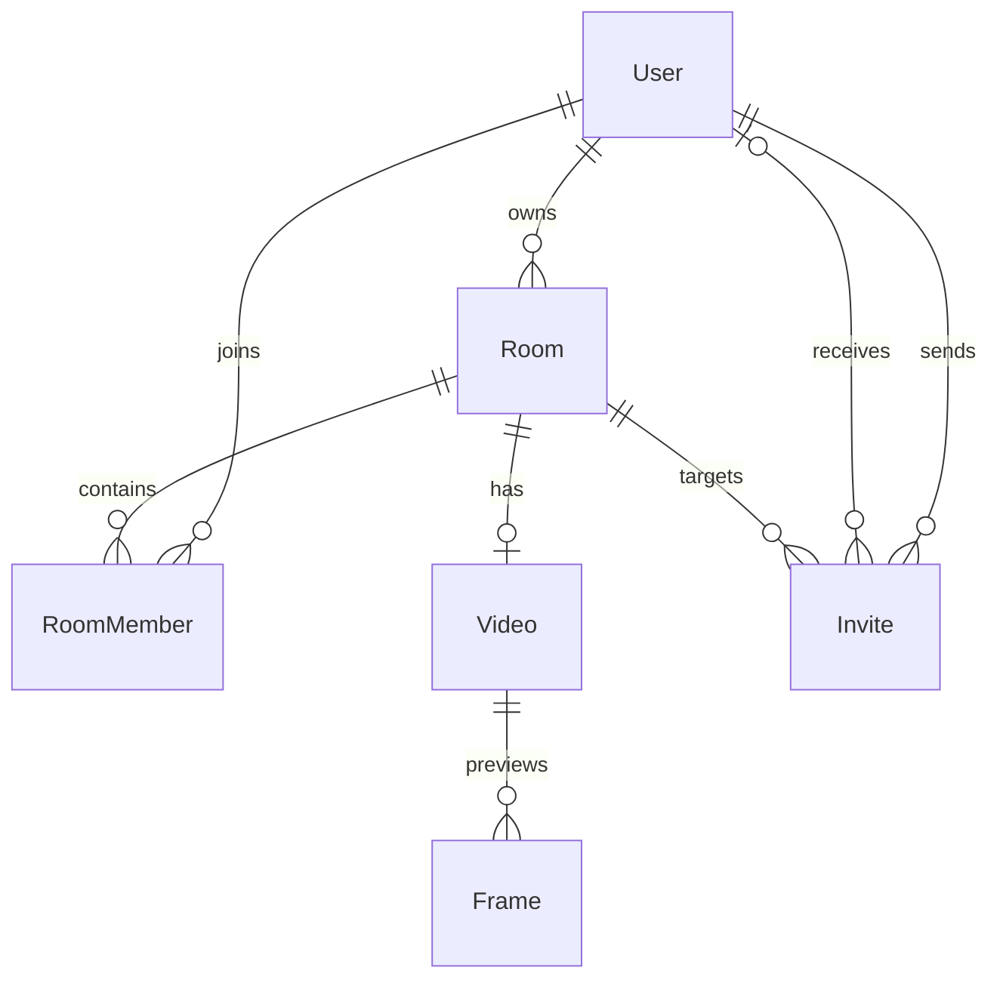

# Podcazt

For measured networking/security results and repeatable local or hosted tests, see
[the 15-metric benchmark suite](#reproducible-networking-and-security-metrics).

For AWS EC2 deployment and GitHub Actions CI/CD, follow [the AWS deployment guide](deploy/aws/README.md).
The shared Ubuntu deployment also works on Lightsail. It includes Docker Compose,
Nginx, Certbot renewal, Coturn, private S3 recording storage, and PostgreSQL backups.
The sections below also describe the original Supabase/Metered development configuration.

To test the deployment locally with Docker, Nginx, trusted local HTTPS, and
Coturn, follow [the local Docker testing guide](deploy/local/README.md).

Podcazt is a browser recording platform for solo sessions and remote podcasts. It combines a Next.js web application, peer-to-peer WebRTC calls, an authenticated WebSocket signaling service, PostgreSQL, Supabase Storage, Redis, and email delivery.

The room owner can invite a participant, start a live call, record the visible participant grid, and upload the final recording. Participants can control their own camera and microphone, but server-side checks prevent them from recording or managing the room.

## System architecture



The Next.js application handles pages, authentication, authorization, room data, invites, uploads, and the dashboard. The signaling service handles long-lived WebSocket connections. WebRTC sends live camera and microphone data directly between browsers. PostgreSQL stores relational data. Supabase Storage stores large video and image objects. Redis coordinates rate limits and realtime events across server instances.

### Why WebRTC and WebSocket are separate

WebRTC carries the audio and video. It is designed for low-latency media and can send media directly between browsers.

Before two browsers can create that connection, they must exchange small setup messages. These messages contain an offer, an answer, and ICE candidates. An ICE candidate describes a network path that WebRTC can try. The WebSocket service routes these setup messages to the correct peer. It does not carry the video itself.

STUN helps a browser discover its public network address. When a direct route is blocked by a firewall or symmetric NAT, the optional TURN configuration relays media between participants.

## Runtime services

The project has two server processes:

1. The Next.js process serves the site and HTTP API.
2. The signaling process keeps WebSocket connections open and routes realtime messages.

Both processes use the same `SESSION_SECRET`. The Next.js process creates a short-lived realtime token. The signaling process verifies that token, reads the user identity from it, and checks room membership in PostgreSQL before allowing a room join.

Redis is optional for one signaling instance. It becomes important when several signaling instances are running because it broadcasts invite notifications across all instances. Without Redis, the Next.js process can send the event to the signaling service through its protected internal HTTP endpoint.

## Authentication and persistent sessions

Authentication is stateless. Stateless means the server does not store a session row for each signed-in browser.

After sign-up or login:

1. The password is checked with bcrypt.
2. The server creates a signed JWT.
3. The JWT is stored in an `HttpOnly` cookie for 30 days.
4. Each protected request verifies the JWT signature and claims.
5. The user identity is read from the token without a database query.

The JWT uses these checks:

- `HS256` is the only accepted signing algorithm.
- `sub` contains the user ID.
- `iss` identifies Podcazt as the issuer.
- `aud` limits the token to the Podcazt web application.
- `jti` gives each token a unique ID.
- `iat` records when the token was issued.
- `exp` ends the session after 30 days.
- `typ` separates session tokens from other token types.

The cookie is `HttpOnly`, so browser JavaScript cannot read it. `SameSite=Lax` reduces cross-site request attacks. Production cookies require HTTPS. Cookie priority is set to high so browsers are less likely to remove it under storage pressure.

`SESSION_SECRET_PREVIOUS` supports key rotation. During a rotation, new tokens use `SESSION_SECRET`, while old tokens can still be verified with the previous key. After the longest token lifetime has passed, the previous key can be removed.

Stateless sessions have a clear tradeoff: removing a server-side session is not needed, but one token cannot be revoked immediately without adding a deny list or a user session version. Logout removes the browser cookie. Secret rotation invalidates a wider group of tokens.

## Realtime room flow

1. A signed-in user opens a recording room.
2. The browser asks `/api/realtime-token` for a ten-minute signaling token.
3. The browser connects to the signaling service over `wss://`.
4. The signaling service verifies the token and registers the connection under the authenticated email.
5. The browser sends a room join message.
6. The signaling service checks whether the user owns the room or has a `RoomMember` row.
7. Existing peers are returned to the new peer.
8. Browsers exchange WebRTC offers, answers, and ICE candidates through the socket.
9. Camera and microphone tracks then move between browsers over WebRTC.
10. Heartbeat messages detect broken sockets and remove disconnected peers.

The client never chooses its trusted peer identity. The signaling server creates the peer ID and attaches the verified user identity. This prevents a client from joining as another user.

## Invite and notification flow

1. The owner submits a participant email.
2. The API verifies the JWT, room access, room type, room state, and ownership.
3. PostgreSQL stores one invite per room and email pair.
4. The API publishes an invite event through Redis or the protected signaling endpoint.
5. The signaling service finds sockets registered under the invited email.
6. The dashboard bell receives the event immediately and updates its count.
7. Email delivery sends the same invite link for users who are offline.
8. Accepting the invite creates an indexed `RoomMember` row and changes the invite status in one transaction.

No browser polling is used for new notifications. The initial notification list is loaded with the dashboard page, and later notifications arrive through the open socket.

## Recording and upload flow

Only the room owner can record. This rule exists in both the interface and the upload API.

The recorder creates an off-screen 1280 by 720 canvas. Every animation frame draws the active video elements into a grid. Web Audio combines the active audio streams. `MediaRecorder` records the canvas video track and the mixed audio track.

The upload is split into chunks and staged in IndexedDB. IndexedDB is the browser database. Unlike an in-memory array, it can hold large binary chunks without keeping the whole recording in JavaScript memory.

1. The browser records a chunk every two seconds.
2. Each chunk is committed to IndexedDB. Strict durability is requested when the browser supports it.
3. Recording stop waits for every local write to finish.
4. The browser reads the chunks back in index order and checks that no index is missing.
5. The browser calculates a SHA-256 hash for each chunk.
6. Chunks upload one at a time to Supabase Storage.
7. The server calculates the hash again and rejects changed data.
8. The completion request downloads the ordered chunks and joins them.
9. The final file is uploaded to `recordings/{videoId}/video.webm`.
10. PostgreSQL stores the storage path, MIME type, byte size, final SHA-256 hash, public link, and completion time.
11. A JPEG frame is uploaded to `recordings/{videoId}/preview.jpg`.
12. Temporary object-store chunks and local IndexedDB chunks are removed only after successful final assembly.

If upload fails, the local chunks remain available and the studio shows a retry action. Ending the room waits for an active upload, so leaving the page cannot silently interrupt the final transfer.

Temporary server chunks use `uploads/{recordingId}/chunks/{chunkIndex}.webm`. The random recording ID separates unfinished upload attempts. The final video ID already links to its room and owner in PostgreSQL, so permanent paths do not repeat those IDs.

Sequential upload avoids several simultaneous large requests. IndexedDB prevents the full recording from living only in memory. Hash verification detects transmission errors. A recording is visible on the dashboard only when `completedAt` is present, so an empty room is never shown as a pending video.

The studio reads WebRTC statistics every two seconds. It displays video frames encoded, sent, received, decoded, and dropped, plus lost RTP packets. RTP is the packet format used to carry WebRTC media. These counters show whether frames are flowing and whether the browser reports loss. WebRTC can recover from some network loss, but no realtime network can promise delivery of every captured frame.

## Normalized database design

Normalization means each fact has one main place in the database. It reduces duplicate values and prevents two copies of the same fact from becoming different.



### Tables

`users` stores identity, the bcrypt password hash, and profile fields.

`rooms` stores the room name, type, owner, creation time, and closing time. Room name and owner are not copied into the recording table.

`room_members` is an explicit join table. Its composite primary key is `(room_id, user_id)`, so one user cannot join the same room twice. The owner is represented by `rooms.room_owner_id`; only participants need membership rows.

`videos` stores one recording for one room. `room_id` is unique, which enforces the one-to-one relationship. Content metadata lives here because it describes the recorded object.

`frames` stores preview images for a recording. The newest frame can be selected by the `(video_id, created_at)` index.

`invites` stores one invitation per room and email pair. Re-sending a declined invite updates the same row instead of creating repeated data.

### Indexes and query speed

Indexes are shaped around application queries:

- `(room_id, user_id)` gives a fast logarithmic room membership lookup through a unique B-tree key.
- `(user_id, joined_at)` supports a user’s recent room memberships.
- `(room_owner_id, created_at)` supports recent owner rooms.
- `videos.room_id` supports the one-to-one room lookup.
- `videos.completed_at` supports completed recording order.
- `(video_id, created_at)` supports the latest preview frame.
- `(invited_email, status, created_at)` supports the notification list.
- `(inviter_id, created_at)` supports invite history.
- `(room_id, invited_email)` prevents duplicate invites and gives direct invite lookup.

Room authorization now uses one filtered query with an indexed membership existence check. It does not load every room member. The roster is fetched only on the recording page, where the names are actually displayed.

The authenticated layout loads active invites once for the persistent notification bell. The dashboard performs a separate focused query that selects only completed videos and the newest frame. Realtime invite events update the shared bell after the initial page load.

## Authorization boundaries

Authentication answers “who is this user?” Authorization answers “may this user perform this action?”

The main authorization rules are:

- A room owner can invite participants, record, upload frames, and close the room.
- A participant can join only after accepting an invite.
- A participant can control only local camera and microphone tracks.
- A closed room cannot be joined or accepted.
- An invite can be accepted only by the email address that received it.
- The signaling service repeats the room membership check instead of trusting the web page.

Hiding a button is not treated as security. Sensitive API routes repeat the owner check because a user can call an HTTP endpoint without using the page.

## Rate limiting and distributed state

API routes call a shared rate-limit helper. If `REDIS_URL` is available, standard Redis stores counters. Upstash REST is supported for serverless HTTP deployments. A process-memory fallback keeps local development working.

Redis is also used as pub/sub. Pub/sub means one process publishes an event to a channel and every subscribed process receives it. This allows any Next.js instance to reach a user connected to any signaling instance.

The WebSocket service keeps active sockets in memory because sockets belong to one running process. Redis distributes events, while each process sends the final message to its own connected sockets.

## Storage design

PostgreSQL stores metadata and relationships. Supabase Storage stores video chunks, completed recordings, and preview images. Keeping large binary objects outside PostgreSQL prevents large table rows and makes object delivery easier to scale.

Temporary chunks use a random recording ID. Permanent video and preview objects use the normalized video ID. Authorization and ownership remain in PostgreSQL instead of being repeated in object paths.

The project currently uses Supabase public URLs. A private production library can replace these with short-lived signed URLs without changing the normalized recording relationship.

## Failure handling

- Invalid JWTs return an unauthorized response.
- Invalid input is rejected by Zod before database work starts.
- Database room creation and invite acceptance use transactions.
- Duplicate invitations are blocked by both application checks and a unique database index.
- Socket messages have a size limit and invalid messages are ignored.
- Socket heartbeats remove dead peer connections.
- Missing recording chunks stop final assembly.
- Hash mismatches stop the upload.
- Email failure does not remove the database invite.
- Realtime delivery can fall back from Redis to the protected signaling endpoint.
- Failed direct WebRTC paths are reported to participants.

## Source file map

### Root files

| File | Responsibility |
| --- | --- |
| `.env.example` | Lists application, database, storage, email, Redis, signaling, and JWT key-rotation settings. |
| `README.md` | Describes system architecture, data flow, security, deployment, and source ownership. |
| `package.json` | Defines dependencies and commands for Next.js, Prisma, linting, type checking, and the signaling service. |
| `package-lock.json` | Locks exact dependency versions for repeatable installs. |
| `next.config.ts` | Separates development and production build directories, enables strict React behavior, removes the framework header, and adds browser security headers. |
| `next-env.d.ts` | Adds generated Next.js TypeScript declarations. It is managed by Next.js. |
| `tsconfig.json` | Configures strict TypeScript, browser libraries, module resolution, JSX, and the `@/` path alias. |
| `eslint.config.mjs` | Applies Next.js, React, accessibility, and TypeScript lint rules. |

### Pages and layouts

| File | Responsibility |
| --- | --- |
| `app/layout.tsx` | Defines document metadata and the shared shell. It verifies the stateless session, applies the authenticated body theme, loads initial invites, and keeps the notification bell in every signed-in page. |
| `app/globals.css` | Contains public and authenticated design tokens, full-page black overscroll styling, responsive navigation, studio grid, recording controls, cards, forms, dashboard, and notification popover styles. |
| `app/page.tsx` | Renders the public landing page. |
| `app/signin/page.tsx` | Renders the combined account creation and login screen. |
| `app/login/page.tsx` | Redirects the old `/login` path to `/signin`. |
| `app/dashboard/page.tsx` | Verifies the JWT, loads completed recordings with their newest preview frame, and renders the recording library. |
| `app/create/page.tsx` | Protects and renders the room creation page. |
| `app/permissions/page.tsx` | Protects and renders the camera and microphone preflight step. |
| `app/record/[roomId]/page.tsx` | Verifies room access, loads the roster, decides whether the user is the owner, and renders the realtime studio. |
| `app/invite/[inviteId]/page.tsx` | Validates an invite against the signed-in email and renders its acceptance state. |
| `app/ended/page.tsx` | Shows the room-ended result and links back to the dashboard. |

### Client components

| File | Responsibility |
| --- | --- |
| `components/AuthForm.tsx` | Switches between sign-up and login, validates browser fields, calls the auth API, and refreshes the authenticated route state. |
| `components/CreateRoomForm.tsx` | Creates podcast or solo rooms and moves the owner to device permissions. |
| `components/PermissionGate.tsx` | Requests real browser media permission, stops the test stream, and enters the selected room. |
| `components/Recorder.tsx` | Owns local media, WebSocket signaling, WebRTC peer connections, frame transport statistics, the participant grid, owner-only composite recording, local chunk staging, hashing, upload, frame capture, and room exit. |
| `components/InviteParticipant.tsx` | Lets the owner create an email and realtime invite and shows delivery status. |
| `components/AcceptInviteButton.tsx` | Accepts an invite and sends the participant to the permission step. |
| `components/NotificationBell.tsx` | Stays mounted in the authenticated navigation, opens a notification socket, adds invite events without polling, removes accepted invites, displays the active count, and links to invite pages. |
| `components/ProfileMenu.tsx` | Opens from the authenticated profile icon on hover or keyboard focus, shows the current identity, clears the JWT cookie through the logout API, and returns to the public homepage. |

### Authentication and shared server libraries

| File | Responsibility |
| --- | --- |
| `lib/auth.ts` | Creates and verifies 30-day stateless JWT sessions, handles secure cookies, memoizes verification per request, and supports signing-key rotation. |
| `lib/realtime-token.ts` | Creates and verifies short-lived JWTs used only by the WebSocket signaling service. |
| `lib/types.ts` | Holds shared TypeScript shapes, including the trusted session user. |
| `lib/env.ts` | Reads required and optional environment variables and resolves a safe public application origin. |
| `lib/prisma.ts` | Creates one reusable Prisma client per server process and avoids extra clients during development reloads. |
| `lib/api.ts` | Provides consistent JSON success, error, and rate-limit responses. |
| `lib/validation.ts` | Defines Zod schemas for credentials, rooms, invites, upload chunks, completion messages, and preview frames. |
| `lib/client-error.ts` | Extracts safe, readable messages from API failures for client components. |
| `lib/rooms.ts` | Converts room kinds, creates normalized room and recording rows in one transaction, performs indexed access checks, and loads the roster only when needed. |
| `lib/control-route.ts` | Provides shared authentication and room validation for compatibility control endpoints. Media changes themselves stay local to WebRTC tracks. |

### Realtime, cache, email, and storage libraries

| File | Responsibility |
| --- | --- |
| `lib/realtime-client.ts` | Fetches a realtime token and builds the correct development or production WebSocket URL. |
| `lib/realtime-events.ts` | Publishes invite notifications through Redis or the protected signaling HTTP endpoint. |
| `lib/recording-store.ts` | Stores ordered recording chunks in IndexedDB before upload, reads them back for verification, and removes them after successful completion. |
| `lib/redis.ts` | Creates a reusable standard Redis client and an Upstash REST command client. |
| `lib/rate-limit.ts` | Implements request limits with standard Redis, Upstash REST, or an in-memory development fallback. |
| `lib/email.ts` | Builds escaped text and HTML invitation messages, chooses the public invite URL, and sends through Gmail. |
| `lib/supabase.ts` | Creates the server storage client and exposes browser storage configuration. |

### Authentication API routes

| File | Responsibility |
| --- | --- |
| `app/api/signin/route.ts` | Validates account data, hashes the password, creates the user, and writes the persistent JWT cookie. |
| `app/api/login/route.ts` | Finds the user, compares the bcrypt hash, and writes the persistent JWT cookie. |
| `app/api/logout/route.ts` | Removes the session cookie. |
| `app/api/me/route.ts` | Returns the verified identity from the JWT without loading the user from PostgreSQL. |
| `app/api/realtime-token/route.ts` | Exchanges the persistent web session for a short-lived signaling token. |

### Room and invite API routes

| File | Responsibility |
| --- | --- |
| `app/api/create/route.ts` | General room creation endpoint with validated room type. |
| `app/api/podcast/route.ts` | Creates a podcast room and its empty recording metadata row. |
| `app/api/self-record/route.ts` | Creates a solo room and its empty recording metadata row. |
| `app/api/inviteOther/route.ts` | Enforces owner-only invites, reuses the normalized invite row, publishes realtime events, and sends email. |
| `app/api/incomingInvites/route.ts` | Returns active invites for the authenticated email. |
| `app/api/incomingInvities/route.ts` | Keeps compatibility with the earlier misspelled incoming-invites URL by exporting the correct handler. |
| `app/api/invites/[inviteId]/accept/route.ts` | Checks invite ownership and room state, then creates membership and marks acceptance in one transaction. |
| `app/api/leaveCall/route.ts` | Lets a participant leave and marks the room closed when the owner ends it. |
| `app/api/closeRoom/route.ts` | Provides a direct owner-only room closing endpoint. |

### Recording and media API routes

| File | Responsibility |
| --- | --- |
| `app/api/record/route.ts` | Accepts owner-only hashed chunks under the temporary upload path, verifies and assembles them, saves the final video under its video ID, writes metadata, and removes temporary remote chunks. |
| `app/api/frame/route.ts` | Uploads an owner-only JPEG preview beside the final video and links it to the recording. |
| `app/api/myVideos/route.ts` | Returns only completed recordings with room data and the newest frame. BigInt byte size is converted to a JSON string. |
| `app/api/allowCam/route.ts` | Confirms that an authenticated user completed the camera permission step. |
| `app/api/allowMic/route.ts` | Confirms that an authenticated user completed the microphone permission step. |
| `app/api/cam/route.ts` | Compatibility endpoint that validates authenticated room camera control messages. |
| `app/api/mic/route.ts` | Compatibility endpoint that validates authenticated room microphone control messages. |
| `app/api/raiseHand/route.ts` | Compatibility endpoint for an authenticated room hand-state message. |
| `app/api/shareScreen/route.ts` | Compatibility endpoint for an authenticated room screen-sharing state message. |

### Signaling service

| File | Responsibility |
| --- | --- |
| `server/signaling.ts` | Runs Express and WebSocket on one HTTP server, authenticates upgrades, checks database room membership, assigns peer IDs, routes SDP and ICE messages, sends room events, delivers invite notifications, supports Redis pub/sub, performs heartbeat cleanup, and handles graceful shutdown. |

### Database files

| File | Responsibility |
| --- | --- |
| `prisma/schema.prisma` | Defines normalized PostgreSQL models, one-to-one recording ownership, explicit room membership, invite uniqueness, cascade rules, and query-shaped indexes. |
| `prisma/manual/normalize_existing.sql` | Converts a database created with the older implicit membership and duplicated video model. It preserves memberships and recordings, removes duplicated fields, deduplicates invites, and runs inside one transaction. |

## Local setup

1. Copy the environment template.

```bash
cp .env.example .env
```

2. Set a PostgreSQL connection and a random `SESSION_SECRET` containing at least 32 characters.

3. Install dependencies and generate the Prisma client.

```bash
npm install
npm run db:generate
```

4. For a new empty database, create the normalized tables.

```bash
npm run db:push
```

5. For a database that already uses the older schema, back it up and apply the one-time conversion instead of `db:push`.

```bash
psql "$DATABASE_URL" -f prisma/manual/normalize_existing.sql
npm run db:generate
```

6. Start Next.js and the signaling service in separate terminals.

```bash
npm run dev
npm run dev:signal
```

Local signaling defaults to `ws://localhost:4000`. Camera access works on localhost. Production camera and microphone access require HTTPS.

## Environment variables

### Application and authentication

- `NEXT_PUBLIC_APP_URL`: public HTTPS origin used in invite links.
- `SESSION_SECRET`: current JWT signing key. Use at least 32 random characters.
- `SESSION_SECRET_PREVIOUS`: optional previous JWT key during rotation.
- `DATABASE_URL`: PostgreSQL connection used by Prisma.

### Signaling and WebRTC

- `NEXT_PUBLIC_SIGNALING_URL`: public `wss://` signaling address.
- `SIGNALING_PORT`: signaling process port.
- `SIGNALING_INTERNAL_URL`: private HTTP address used for direct invite event delivery.
- `SIGNALING_INTERNAL_SECRET`: bearer secret protecting internal event delivery.
- `METERED_TURN_APP_NAME`: Metered application subdomain used to request its ICE server array.
- `METERED_TURN_API_KEY`: server-only Metered credential API key used by the authenticated TURN credentials endpoint.

### Storage

- `NEXT_PUBLIC_SUPABASE_URL`: Supabase project URL.
- `NEXT_PUBLIC_SUPABASE_ANON_KEY`: limited browser key.
- `SUPABASE_SERVICE_ROLE_KEY`: private server storage key.
- `SUPABASE_VIDEOS_BUCKET`: object bucket for chunks, recordings, and frames.

### Redis

- `REDIS_URL`: standard Redis connection for pub/sub and rate limiting.
- `UPSTASH_REDIS_REST_URL`: Upstash REST endpoint for serverless rate limiting.
- `UPSTASH_REDIS_REST_TOKEN`: Upstash REST credential.

### Email

- `GOOGLE_EMAIL`: Gmail account used as the sender.
- `GOOGLE_APP_PASSWORD`: Google application password.
- `GOOGLE_FROM_NAME`: visible sender name.

## Commands

| Command | Purpose |
| --- | --- |
| `npm run dev` | Starts the Next.js development server. |
| `npm run dev:signal` | Starts the signaling service with `.env`. |
| `npm run build` | Produces and validates the optimized Next.js build. |
| `npm run start` | Starts the built Next.js application. |
| `npm run start:signal` | Starts the signaling service in production mode. |
| `npm run lint` | Runs ESLint. |
| `npm run typecheck` | Runs strict TypeScript checking without output files. |
| `npm run db:generate` | Regenerates the Prisma client after schema changes. |
| `npm run db:push` | Synchronizes an empty or development database with the Prisma schema. |
| `npm run db:studio` | Opens Prisma Studio for database inspection. |

## Production layout

Run the Next.js process behind HTTPS. Run the signaling process on infrastructure that supports persistent WebSocket connections. Expose it through `wss://` and keep its internal event endpoint private.

Use PostgreSQL connection pooling for serverless Next.js instances. Set `REDIS_URL` on the signaling service when more than one signaling instance can run; Redis relays peer presence, SDP, ICE candidates, room endings, and notifications between instances. Configure a TURN service for reliable calls across restrictive networks. Keep Supabase service keys, Gmail credentials, database URLs, JWT secrets, and internal signaling secrets on the server.

The Next.js process can scale horizontally because sessions are stateless and uploaded objects live outside the process. The signaling process can also scale horizontally when Redis distributes notifications. WebRTC media stays between peers or passes through TURN, so the application servers do not become the main video bandwidth path.

## Reproducible networking and security metrics

The suite measures **15 component metrics**, saves raw observations, and exits nonzero for failed/unavailable metrics or failed optional budgets. Results are evidence for the tested workload; they are not maximum capacity claims. Use the hosted suite for production measurements and the isolated local suite for development comparisons.

### Run against the hosted EC2 deployment

Prerequisites: Node.js 22.9+ (Node 22 LTS recommended), Docker Compose for local tests, OpenSSL for local TLS, SSH/SCP, the EC2 SSH key, and the server's verified key in `~/.ssh/known_hosts`. Do not disable host-key verification. Install the locked dependencies and pinned Chromium:

```bash
npm ci
npm run metrics:browsers
cp .env.metrics.example .env.metrics
npm run metrics:hosted
# Repeat a selected hosted component without the full suite:
npm run metrics:hosted -- --only=webrtc
```

The default target is `https://podcazt.arisen37.xyz`, SSH host `13.51.197.83`, user `ubuntu`, key `enryu.pem`, deployment `/opt/podcazt/deploy/aws`. Set the `METRICS_SSH_*`, `METRICS_HOSTED_URL` and `METRICS_DEPLOY_DIR` values in `.env.metrics` when the deployment changes. Keep `.env.metrics` and private keys untracked. The hosted runner requires permission to run `sudo docker compose` on your deployment and an existing healthy web/Postgres/Redis stack with private S3 and TURN configured. It reuses the production image and its environment; it does not install dependencies or rebuild the app on EC2.

Hosted groups are `http,tls,backend,signaling,upload,webrtc`; `backend` measures M03–M07. Use `--only=` with a comma-separated subset. For all comparisons, the hosted runner fixes DB fixture size at one active room, backend concurrency at four, and Redis subscribers at three. Sample/warmup counts, upload part count, media trials and durations are configurable through their `METRICS_*` settings.

The hosted workload is intentionally bounded: 100 samples, 10 warmups where applicable, HTTP/DB concurrency 4, three Redis subscribers, a 40-request rate-limit burst, one active test room plus one closed test room, and three 10-second WebRTC trials with synthetic 1280×720 video at requested 30 FPS. Upload testing sends six fixed 8 MiB parts (48 MiB useful payload), one deliberate retransmission, and one corrupt-part probe. Hosted S3 testing aborts the multipart session after listing and validating uploaded parts; completion and download are excluded because the deployment policy lacks `s3:DeleteObject`. No IAM permissions are changed. Expect S3/TURN traffic charges. This is a small benchmark, not a stress test. WebRTC peers run in separate Chromium processes on the client machine and **force relay through the hosted TURN service**. Each peer obtains credentials through its own authenticated test-user session. It checks both selected relay candidates. This exercises the deployed media path but does not represent two geographically separate users.

HTTPS/WSS/upload/WebRTC timings are observed on the client; JWT, Redis and DB timings are observed in a temporary container on EC2 using the deployed application's real helpers. The report records whether signaling actually uses Redis or in-process routing; Redis pub/sub is tested independently in either case. Public API checks in M04 run from EC2 against the internal web service; public TLS is covered separately by M02.

### What temporary fixtures mean

A fixture is reproducibly generated input: an owner, a member, an outsider, their two rooms, a membership, and deterministic sample bytes. Each run creates the **same logical setup with unique IDs** so it cannot collide with real users or another run. The owner/member/outsider emails use `.invalid`, passwords are unusable, and no invitations or email are sent. UUIDs and short-lived tokens vary for isolation; payload bytes, authorization cases, request counts, retry injection, video animation and procedure stay fixed.

Before database writes, the agent records the run-owned IDs in a private state file on EC2. It registers the S3 upload before sending data. A `finally` cleanup aborts any unfinished multipart session, and removes only the three test users and their cascading room/recording rows. The report records cleanup verification. Production tables are not truncated, migrated, or analyzed by this runner. If the client or SSH connection is interrupted, use the run ID printed at startup:

```bash
npm run metrics:hosted -- --cleanup=metrics-RUN-ID
```

That command uses the retained private state and removes the run directory only after cleanup succeeds. Retrying cleanup after a lost connection is the recovery procedure. Do not delete its state directory manually before cleanup. The test never downloads production signing keys, database credentials, or AWS credentials. The SSH key remains on the client, and only short-lived test sessions/tokens are returned from the agent. Exported test sessions expire after ten minutes; tokens and signed S3 URLs are excluded from reports.

### Run locally or select individual components

```bash
npm run metrics:local
# Builds Next.js, starts isolated Postgres/Redis, measures, then removes test containers.
npm run metrics:local -- --only=redis,database
npm run test:metrics
```

For repeated runs without rebuilding, manage the isolated services explicitly:

```bash
npm run metrics:up
npm run build
npm run metrics -- --only=http,tls,auth,security,redis,rate-limit,database,signaling,upload,webrtc
npm run metrics:down
```

Local mode requires the database name `podcazt_metrics`; it overrides application database/Redis environment variables and uses dedicated localhost ports 55432/56379. Its seeded 5,001 rooms are temporary data in that database. Local HTTP uses a verified private CA and a Node TLS proxy to a real production Next.js server. Local upload uses a loopback HTTP fixture; **its goodput is not S3 throughput**. Local media defaults to eligible ICE paths between same-host browsers. Only this private direct-path harness disables Chromium mDNS host-IP hiding so the synthetic peers can resolve each other; production browser settings are unchanged. Configure `METRICS_FORCE_RELAY=true` and short-lived `METRICS_ICE_SERVERS_JSON` to test a relay locally. Hosted mode always obtains authenticated short-lived TURN credentials and forces relay.

For read-only public HTTPS/TLS measurements without SSH or fixtures:

```bash
METRICS_HTTP_URL=https://podcazt.arisen37.xyz npm run metrics -- --only=http,tls
```

### Metric definitions and owning files

| ID | Main component | Measurement | Test file |
| --- | --- | --- | --- |
| M01 | Next.js / HTTPS | Health-response p50/p95/p99, completed requests/s, error percentage at concurrency 4. Includes full response; health does not query the DB. | `http.bench.ts` |
| M02 | TLS | Fresh verified connection p50/p95/p99, negotiated protocol/cipher. Includes DNS, TCP and TLS; excludes HTTP and session resumption. | `http.bench.ts` |
| M03 | Authentication | Real HS256 JWT verification p50/p95/p99 and operations/s, without HTTP or password hashing. | `security.bench.ts` |
| M04 | Access control | Rejection percentage for enumerated JWT/API/room negative cases, with valid-token and authorized-request positive controls. Individual checks are exported. | `security.bench.ts` |
| M05 | Redis pub/sub | Publish-to-callback p50/p95/p99 and delivery percentage, 100 publications to three subscribers. | `redis.bench.ts` |
| M06 | Redis rate limiter | Allowed/blocked counts, latency and over-limit blocking percentage for 40 requests against limit 20; verifies Redis counter and TTL to rule out memory fallback. | `redis.bench.ts` |
| M07 | PostgreSQL / Prisma | Real `assertRoomAccess` query p50/p95/p99 at concurrency 4, fixture/table cardinality, separate representative SQL EXPLAIN ANALYZE/BUFFERS plan. | `database.bench.ts` |
| M08 | WebSocket / authorization | Upgrade-to-authorized-room-join p50/p95/p99; excludes token creation and connection teardown. | `signaling.bench.ts` |
| M09 | Reliable signaling | Offer/answer application echo RTT p50/p95/p99 with 1,024 bytes of padding and delivery percentage; invalid-token and outsider-room checks. Synthetic payloads do not test SDP parsing. | `signaling.bench.ts` |
| M10 | Multipart uploads / SHA-256 | Useful payload Mbit/s, retries, integrity, and corrupt-part rejection with the real selective-repeat scheduler; hosted mode uses actual S3, local mode uses an HTTP fixture. | `hosted-upload.bench.ts`, `upload.bench.ts` |
| M11 | WebRTC / ICE / DTLS / SRTP | Offer request to both connections, first decoded video and data echo; three setup trials. Browser launch/join excluded. | `webrtc.bench.ts` |
| M12 | WebRTC transport | Selected candidate-pair `currentRoundTripTime` p50/p95/p99 in ms. This is not one-way or glass-to-glass latency. | `webrtc.bench.ts`, `webrtc-stats.ts` |
| M13 | RTP video | Packet loss estimate = sum(max(0, Δlost)) / (sum(Δreceived) + sum(max(0, Δlost))) × 100; jitter seconds converted to ms. Late-arrival corrections are recorded separately. | `webrtc-stats.ts` |
| M14 | Video decoder | Receiver drop ratio = Δdropped / (Δdecoded + Δdropped) × 100; decoded FPS from counter/time deltas. Does not count every captured frame missing before reception. | `webrtc-stats.ts` |
| M15 | ICE recovery | Real `IceRecovery` restart latency requiring changed ICE credentials, an answered negotiation, connected ICE and a data echo. Deliberate restart on a working path, not physical Wi-Fi/cellular handover. | `browser.ts`, `webrtc.bench.ts` |

All test files in this table are under `tests/metrics/`. Missing counters are reported as unavailable, never silently converted to zero. Counter resets are excluded. Raw browser counters are filtered to exclude candidate addresses, SDP and credentials. Statistics use the [W3C WebRTC stats definitions](https://www.w3.org/TR/webrtc-stats/); TLS validation uses [Node's TLS API](https://nodejs.org/api/tls.html).

### Supporting file descriptions

| File | Responsibility |
| --- | --- |
| `.env.metrics.example` | Repeatable local/hosted settings, workload counts, ports, browser selection and optional budgets. Copy to ignored `.env.metrics`. |
| `tests/metrics/common.ts` | Shared fixture/context types, finite sample validation, nearest-rank percentiles, bounded settings, timing and timeout helpers. |
| `tests/metrics/compose.yaml` | Isolated temporary Postgres/Redis services bound to localhost, independent of deployment volumes. |
| `tests/metrics/local.ts` | Starts services, builds, runs selected local metrics, and tears down in `finally`. |
| `tests/metrics/run.ts` | Local metric selection, environment isolation, migrations/fixtures, application processes, TLS fixture, cleanup and report generation. |
| `tests/metrics/hosted.ts` | SSH/SCP orchestration, source digest, public endpoints, hosted S3/TURN measurements, automatic cleanup and recovery command. |
| `tests/metrics/hosted-agent.ts` | Runs inside the existing deployed image; creates private fixture state and ten-minute tokens, measures backend helpers, registers/aborts S3 multipart sessions and verifies DB cleanup. |
| `tests/metrics/socket.ts` | Authenticated WebSocket test clients, acknowledgements, bounded inbox waits and teardown. |
| `tests/metrics/browser.ts` | Synthetic video peers using the actual reliable-signaling and ICE-recovery classes, data echoes, safe stats collection and stream cleanup. |
| `tests/metrics/webrtc.bench.ts` | Bundles/launches two Chromium processes, measures M11–M15 and records media trials/selected paths. |
| `tests/metrics/webrtc-stats.ts` | Counter delta validation, RTP/frame arithmetic, unit conversions and authoritative selected-path lookup. |
| `tests/metrics/report.ts` | JSON/Markdown reports, primary metric mapping and explicit optional budget validation. |
| `tests/metrics/budgets.example.json` | Illustrative regression thresholds; these are configurable targets, not observations or promised SLAs. |
| `tests/metrics.test.ts` | Unit tests for percentiles, missing/reset counters, media math, selected-path lookup and budget failure behavior. |
| `tests/metrics/baselines/hosted-2026-10-10-full.json` | Preserved full hosted observations, including TURN quota failures and successful fixture cleanup. |
| `tests/metrics/baselines/hosted-2026-10-10-media.json` | Preserved successful targeted media rerun, raw counters, selected relay paths and cleanup verification. |
| `tests/metrics/baselines/manifest.json` | SHA-256 hashes of both baseline reports and verification that the media source digest matches the current test files. |

### Repeating and comparing results

Each run saves dated JSON/Markdown and `latest.json`/`latest.md` in ignored `artifacts/metrics/` with configuration, timestamps, raw samples, errors and environment details. Percentiles use nearest rank on successful samples; errors are reported separately. With only three media trials, p95/p99 equal the maximum observed trial and do not establish a production tail-latency SLA. Browser RTT observations and Redis deliveries from one publication are correlated. Forced-relay tests allow two seconds after closing peer connections before terminating Chromium, outside timed measurements, so TURN deallocation messages can be sent. Rapid restarts or crashed browsers can still leave allocations until their lease expires; do not reset Coturn or raise quotas just to obtain passing numbers. Hosted reports include the deployed Git revision and a SHA-256 digest of the uploaded benchmark source, client/server Node versions, browser version, CPU/RAM, fixture cardinality, routing mode and selected ICE paths. Keep the same lockfile, browser build, server revision/type, client machine/network and `.env.metrics` for comparisons. Run one benchmark at a time; background load, routing and public-network conditions can change results. Reports preserve observations rather than promising identical latency numbers.

To fail a run on your own performance thresholds, copy `tests/metrics/budgets.example.json`, adjust limits to an established baseline, and set `METRICS_BUDGET_FILE` to that JSON file. A missing value or unavailable/failed selected metric fails its budget. Never copy the example thresholds into a résumé as measured achievements.

Use measured values with their scope in résumé bullets: “Measured p95 authenticated WSS join of X ms over 100 trials,” “Validated all Y enumerated negative auth/access cases with positive controls,” or “Validated per-part SHA-256 checksums for a 48 MiB multipart S3 transfer with one injected retransmission.” Do not infer percentage improvements without an equivalent before/after baseline, claim DDoS resistance from M06, or describe same-host peers as geographically distributed users.

### Hosted observations — 10 October 2026

These are two explicitly separate measured runs, not a single merged raw result. **F** is the [full hosted run](tests/metrics/baselines/hosted-2026-10-10-full.json), started at 15:34:15 UTC. It passed 13/15 metrics; M11/M15 failed because only 1/3 media trials established, with TURN allocation error `486`. **R** is the [targeted media rerun](tests/metrics/baselines/hosted-2026-10-10-media.json), started at 15:44:04 UTC after adding a two-second graceful teardown delay; all five media metrics passed with 3/3 trials. The rerun does not prove the delay alone resolved the quota issue; expired allocations and current load can also affect it. The failed observations remain in F.

Both runs used the deployed revision `7a301678eab7d0030ac8ce02328cdda92a0254d4` on ARM64 EC2 (t4g.small, approximately 1.8 GiB RAM). The client was an Apple M5 Mac with 16 GiB RAM, Node v26.9.0 and Chromium 156.0.8078.4; the EC2 agent used Node v22.23.3. Test source hashes, image ID, configuration and raw samples are in the reports. The media source digest matches the current test files. Both runs verified fixture cleanup; all four production containers remained healthy. Report SHA-256 hashes are in [the baseline manifest](tests/metrics/baselines/manifest.json).

| ID | Component metric | Observed primary value | Source | Evidence / workload |
| --- | --- | --- | --- | --- |
| M01 | HTTP health latency and throughput | 278.107 ms | F | 100 requests, concurrency 4; 17.919 successful requests/s, 0 errors |
| M02 | Verified TLS handshake | 493.880 ms | F | 100 fresh, CA/hostname-verified handshakes |
| M03 | JWT session verification latency | 0.173 ms | F | 100 in-process verifications on EC2 |
| M04 | Authentication and authorization case coverage | 100.000 % | F | 20/20 negative cases rejected; all 23 checks including positive controls passed |
| M05 | Redis pub/sub fan-out latency | 0.463 ms | F | 300/300 deliveries to three subscribers |
| M06 | Redis-backed burst rate-limit enforcement | 100.000 % | F | 20 allowed + 20 blocked; Redis counter/TTL verified |
| M07 | Indexed room authorization lookup | 6.277 ms | F | 100 ORM authorization operations; five total rooms including two fixture rooms |
| M08 | Authenticated WebSocket room join | 932.294 ms | F | 100 authenticated joins |
| M09 | SDP/ICE routing round-trip and delivery | 464.169 ms | F | 100/100 offer/answer echoes; in-process routing on this deployment |
| M10 | Selective-repeat S3 upload goodput and integrity | 20.458 Mbit/s | F | 48 MiB, seven PUT attempts, one injected retry, six matching SHA-256 checksums; corrupt part rejected |
| M11 | WebRTC media establishment latency | 2763.876 ms | R | 3/3 media trials established; p95 is the maximum of three observations |
| M12 | Selected ICE path round-trip time | 384.000 ms | R | Selected local and remote candidates were relays over UDP |
| M13 | Video RTP packet loss and jitter | 0.000 % | R | 0 estimated lost / 3,517 received video RTP packets; jitter p95 6 ms |
| M14 | Receiver video frame drops and decoded FPS | 0.000 % | R | 0 drops / 1,548 decoded frames; mean decoded FPS 25.616 |
| M15 | Controlled ICE restart recovery | 787.100 ms | R | 3/3 controlled restart trials completed; working path, not physical network handover |

Latency values above are p95 of successful observations, with failures preserved in their source reports. M04/M06 are percentages for their bounded case matrices; M10 is useful payload goodput; M13/M14 are aggregate counter-delta ratios. Zero observed loss/drops in these short synthetic trials does not promise lossless production media.

`486` is [TURN Allocation Quota Reached (RFC 8656)](https://www.rfc-editor.org/rfc/rfc8656.html#section-19). The deployed Coturn settings are `user-quota=12` and `total-quota=80`; the benchmark did not change them or restart Coturn. Closed/crashed clients can leave allocations until expiry if deletion is not delivered. The raw diagnostics also preserve host-lookup errors; those alone do not demonstrate a full DNS outage when other candidates connect.

Examples of defensible résumé statements from these observations:

- Measured p95 authenticated WSS room join of **932 ms** and signaling round-trip of **464 ms** across 100 trials against an HTTPS EC2 deployment.
- Validated **20/20 negative JWT/API/room-access cases** with positive controls, and Redis-backed enforcement of **20/20 over-limit requests** in a fixed burst.
- Measured Redis publish-to-subscriber p95 of **0.463 ms** across **300 deliveries to three subscribers** on EC2.
- Transferred **48 MiB** through authenticated multipart S3 upload at **20.458 Mbit/s**, verified **6/6 part checksums**, rejected corrupted data and recovered an injected retransmission.
- Exercised **3/3 TURN-relayed synthetic call setups and controlled ICE restarts** in the targeted rerun, with restart p95 **787 ms**; retained quota-failure diagnostics from the preceding full run.
